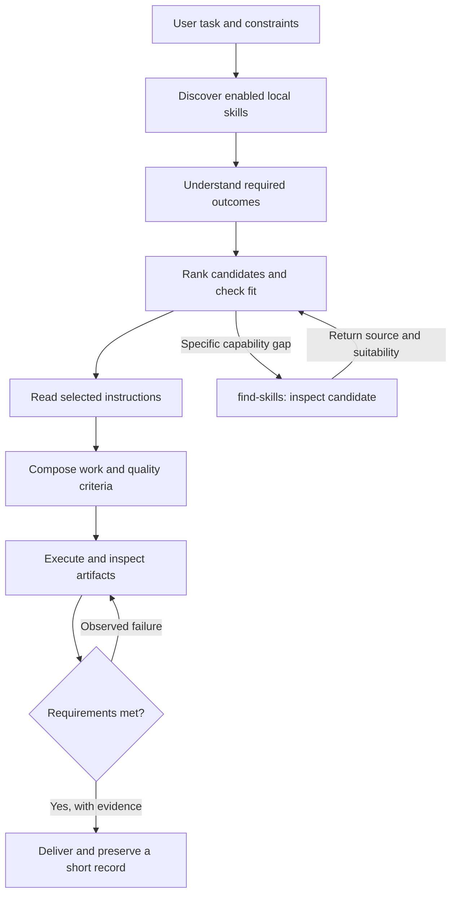

# SkillRouter

**Find the right skills. Read their actual instructions. Check what they promised.**

SkillRouter is a local routing skill for Codex and other agents that can read `SKILL.md` files. It connects installed capabilities into a task-specific workflow, hands real capability gaps to `find-skills`, and keeps evidence that can be inspected later.

It does not train the model, change its weights, load every skill into every prompt, or claim that a logged check proves good reasoning. Its value is making missed instructions, incompatible skill choices, and unsupported completion claims easier to catch.



## What is included

| Capability | Concrete behavior |
| --- | --- |
| Local discovery | Indexes valid metadata, paths, hashes and invocation policy; reports invalid or unreadable skills. |
| Explainable retrieval | Returns lexical candidates with matched terms. The agent still checks meaning, exclusions and prerequisites. |
| Skill composition | Gives each selected skill a task-specific purpose and preserves dependency order. |
| Actual instruction loading | Emits selected instructions and records a separate acknowledgement by the agent. |
| Quality contracts | Links exact source excerpts to observable acceptance checks and evidence. |
| Freshness checks | Detects changed/missing instructions and evidence artifacts before counting a run as verified. |
| Persistent retrieval | Keeps local runs and lessons available across sessions without claiming permanent model memory. |
| find-skills integration | Checks local coverage, discovers a specific gap, and returns to execution without recursive handoffs. |

Everything runs locally. The router has no API keys, telemetry, hosted service, or automatic package installation. It never executes commands found in skill text. The only runtime dependency is PyYAML 6.x for correct YAML parsing.

## Install

Requires Python 3.10 or newer and Git. From a cloned checkout:

```sh
git clone https://github.com/frabcd/skill-router.git
cd skill-router
python -m pip install "PyYAML>=6.0,<7"
python scripts/install.py --activate --link-find-skills
```

Use the actual Python executable path if `python` is not configured. A private repository requires GitHub access.

The installer copies `skills/skill-router` to `$CODEX_HOME/skills/skill-router` (default `~/.codex/skills/skill-router`). `--activate` appends a small routing hook to the active global `AGENTS.md` or `AGENTS.override.md`. `--link-find-skills` appends a bridge to an **existing** personal `find-skills` installation. Omit that flag when find-skills is not installed there. Neither integration replaces unrelated instructions, and original bytes are backed up in `$CODEX_HOME/skill-router/backups`.

Automatic skill selection remains enabled. The skill is available on the next turn; start a new Codex session to load newly added global instructions. Ordinary tasks with one obvious skill can use it directly. Substantial tasks or ambiguous choices use the router. The hook is guidance, not a host-enforced execution gate. It records the interpreter used by the installer so later sessions can run the CLI without guessing; keep that interpreter available or update the hook after moving it.

If using the Skills CLI, the repository also follows its standard skill-folder layout:

```sh
npx skills add frabcd/skill-router --skill skill-router
```

That installs the skill only; use the repository installer for the optional Codex global hook and find-skills bridge. The router does not redistribute or silently install find-skills or your other third-party skills.

## Use it

```text
Use $skill-router to choose the skills for this task, read their guidance,
and check the result against their applicable requirements:
[your task]
```

Examples:

- A 3D interactive explanation needs appropriate UI and rendering capabilities. An image-to-3D skill only applies when its required reference image exists. A diagram naming “Superpowers” does not mean that skill is installed.
- A ManimGL task uses the `manimlib` workflow; Community Edition guidance is not interchangeable.
- A missing file-format capability can go to `find-skills`. An installation requires authorization; a discovery request alone does not grant it.
- A small typo fix does not need a catalog scan or a multi-skill plan.

## Inspect the catalog and records

```sh
python skills/skill-router/scripts/router.py --state .skill-router index --root /path/to/skills
python skills/skill-router/scripts/router.py --state .skill-router rank "make a mathematical animation"
python skills/skill-router/scripts/router.py --state .skill-router coverage
python skills/skill-router/scripts/router.py --state .skill-router recall --limit 3
```

Repeat `--root` for known-enabled plugin roots. With no roots, the first index uses existing personal Codex skills, personal `.agents/skills`, and the current project's `.agents/skills`; subsequent indexes refresh saved roots. It does not infer enabled plugins from every version in a cache.

The [CLI reference](skills/skill-router/references/cli.md) gives the full load -> acknowledge -> criterion -> evidence -> verify workflow. State defaults outside the repository to `$CODEX_HOME/skill-router`; `.skill-router/` is ignored when project-local state is selected. Keep task labels and notes non-sensitive. `coverage` distinguishes indexed, loaded, acknowledged and currently verified uses. It does not treat an unused skill as a failure.

## Trust and limits

`verify` checks record completeness, exact excerpts, source freshness and optional artifact hashes. It cannot prove that an agent comprehended emitted text, chose sufficient criteria, told the truth about an inspection, or produced an excellent result. Evidence is explicitly labeled as agent attestation. Review the actual artifact and the contract, not just a green status.

Lexical ranking does not understand every synonym or negation. Candidate order is a retrieval aid, not an intelligence score. The skill requires semantic selection against the user's scope and the live session's availability. Read receipts from an earlier session are not permission to skip reloading instructions after compaction or a fresh session.

Keep local inventories, paths, records and backups private. No such state is included in this repository. Local JSON is editable and is not a tamper-proof audit log. Use one writer per run. A source-changing contract replacement retains the prior criterion and evidence; a failed check must not be removed simply to produce a pass.

## Test and maintain

```sh
python -m unittest discover -s tests -v
```

Tests cover duplicate names, explicit-only skills, metadata parsing, missing roots, stale source/evidence rejection, contract revisions, persistence, unsafe paths, and non-destructive/idempotent integration. GitHub Actions runs the suite on Windows and Linux with Python 3.10 and 3.12. A symlink test skips when the host does not allow creating symlinks.

The installer intentionally refuses to overwrite a different installed router. Inspect local modifications before updating; use a reviewed replacement rather than silently losing changes. Remove just the managed integration blocks with:

```sh
python scripts/install.py --remove-hooks
```

This retains the installed skill, user instructions, backups and local records. User-owned records can be deleted separately when you want to forget them.

## Design references

- [Codex skill loading and progressive disclosure](https://learn.chatgpt.com/docs/build-skills)
- [Persistent Codex guidance with AGENTS.md](https://learn.chatgpt.com/docs/agent-configuration/agents-md)
- [Agent Skills specification](https://agentskills.io/specification)
- [Find Skills ecosystem](https://skills.sh/)

MIT licensed. Created for **frabcd**, with implementation commits authored by **codex**.
